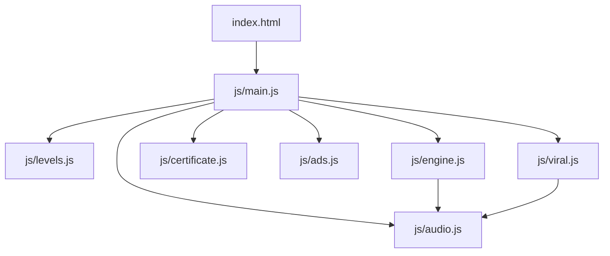

# GROUT — Phase 0: Independent Engineering & Product Audit Report

**Target Repository:** `https://github.com/FaaizNaved/Grout`  
**Production Deployment:** `https://grout-web-game.vercel.app`  
**Audit Branch:** `audit/phase-0-review`  
**Audit Date:** November 24, 2026 (Revised & Verified)  
**AdSense Publisher ID Audited:** `pub-3896262766732996`  

---

## 1. Executive Summary

A comprehensive, evidence-based technical and product audit of the **GROUT** web application was conducted across its source code, runtime mechanics, visual hierarchy, audio synthesis, level architecture, Google AdSense integration, SEO discoverability, and deployment pipeline.

### High-Level Verdict
The project successfully establishes a culturally resonant premise based on the viral *"Isme Grout Bhar Denge"* (इसमें ग्रोट भर देंगे) meme and has transitioned away from garish neon styling toward warm artisanal earth pigments. However, the application currently exhibits **gameplay logic flaws, technical configuration issues, and ad placement policy risks** that must be resolved prior to production launch:

1. **Gameplay Architecture Defect (Sponge Fills Grout):** The promised two-phase ASMR mechanic (*spread paste with trowel, then buff/clean excess haze with sponge*) is non-existent in the engine. In `engine.js`, the sponge tool executes the exact same gap-filling routine as the trowel with an even larger collision radius (38px vs 26px), allowing players to finish levels invisibly without ever using the trowel or cleaning haze.
2. **AdSense Compliance & Placement Risks:**
   - **Confirmed Policy Violation:** Standard display ad units are embedded inside a modal overlay with a locked 3-second countdown timer (`#adTransitionModal`). Google AdSense policy strictly prohibits placing standard display ads in pop-ups, modal overlays, or forced-countdown interstitials.
   - **Invalid-Click Risk (150px Game Separation Guidance):** The bottom ad banner is located less than 15px beneath the interactive tool deck. Official Google AdSense guidance for HTML5/web games recommends a **minimum distance of 150 pixels** between ad units and interactive game elements/canvas boundaries to prevent accidental clicks.
   - **Technical Configuration Error:** Hardcoded dummy slot IDs (`1234567890`, `9876543210`, `5555555555`) cause HTTP 400 Bad Request errors and 0-fill, preventing real ad delivery.
3. **Canvas State Reset Bug on Window Resize / Mobile Rotation:** Resizing the browser or rotating a mobile phone triggers `handleResize()` in `engine.js`, which re-samples gap points with `filled: false` and resets `filledPointsCount = 0`, but leaves previously drawn strokes on screen. The level becomes uncompletable unless the player scrubs over already-painted joints.
4. **Social Sharing Metadata Failure:** The Open Graph and Twitter preview cards reference an SVG (`/og-preview.svg`) via a relative URL. Major social platforms (WhatsApp, Twitter/X, Facebook, iMessage) require absolute URLs (`https://...`) and raster formats (PNG/JPEG); as a result, **all WhatsApp and Twitter link previews fail to render an image**.
5. **Mobile Ergonomics (Below-the-Fold Canvas):** On mobile viewports (<768px height), the top ad banner and verbose inspection report push the interactive canvas and tool controls completely below the fold (~420px of initial scrolling required before interaction).
6. **Level Homogeneity:** All 9 levels share an identical mechanical loop. Visually, 7 out of 9 levels are flat rectangles with text labels; Level 9 ("Infinite ASMR") is not infinite, but a static 4x4 grid that halts with a victory modal at 84% fill.

---

## 2. Current Architecture & Module Map

```
c:\Freelancing\game\Grout/
├── index.html               # Main single-page application shell & modal containers
├── ads.txt                  # Root AdSense authorized digital seller verification
├── package.json             # Build configuration (Vite v6.4.6 dev dependency)
├── vercel.json              # Vercel deployment headers, cleanUrls, and caching rules
├── README.md                # Project documentation and backstories
├── .gitignore               # Ignores node_modules, dist, logs, env
├── assets/                  # Source vector graphics
│   ├── favicon.svg          # 100x100 SVG icon
│   └── og-preview.svg       # 1200x630 SVG social preview card
├── public/                  # Vite public directory (copied as-is to dist root)
│   ├── ads.txt              # Production ads.txt
│   ├── favicon.svg          # Static favicon
│   └── og-preview.svg       # Static OG image
├── css/
│   └── style.css            # Handcrafted warm minimal theme & responsive layout (846 lines)
└── js/
    ├── main.js              # Application entrypoint & DOM event orchestrator (280 lines)
    ├── engine.js            # HTML5 Canvas 2D rendering & drag interaction engine (520 lines)
    ├── levels.js            # 9 level configurations & color palettes (305 lines)
    ├── audio.js             # Web Audio API procedural synthesis & speech engine (294 lines)
    ├── certificate.js       # Canvas letterpress diploma renderer & exporter (165 lines)
    ├── ads.js               # AdSense slot manager & modal transition timer (83 lines)
    └── viral.js             # Social sharing links & soundboard triggers (73 lines)
```



---

## 3. Feature Verification Matrix

| Feature / Capability | Declared in Code | Verified Status | Actual Observed Behaviour & Defect Notes |
| :--- | :---: | :---: | :--- |
| **Canvas DPI Scaling** | Yes | **Partial** | Scales canvas backing store by `devicePixelRatio`, but resets game progress on resize. |
| **Trowel Grout Spreading** | Yes | **Verified** | Drags and extrudes satin paste along gap lines. Debounced squelch audio triggers. |
| **Sponge Buffing / Polishing** | Yes | **BROKEN** | Sponge fills gaps identically to trowel with 38px collision; no haze removal or cleaning mechanic exists. |
| **Progress Calculation** | Yes | **Verified** | Percentage calculated as `(filledPoints / totalPoints) * 100`. Target threshold is 84%. |
| **Combo / Streak Counter** | Yes | **Verified** | Increments on continuous dragging; resets via 700ms timer. |
| **Web Audio Synthesizer** | Yes | **Verified** | Procedural oscillators generate squelch, scrape, sponge squeak, chime, and fanfare without external audio files. |
| **Meme Voice Clips** | Yes | **Fragile** | Uses browser `SpeechSynthesis`. Falls back to generic robotic American voice if Hindi/Indian English voice is absent. |
| **Mute Toggle & Persistence** | Yes | **Verified** | Persists mute state to `localStorage.getItem('grout_muted')`. Syncs UI label on initialization. |
| **Diploma Canvas Generation** | Yes | **Partial** | Renders 1200x800 letterpress certificate, but long names overflow canvas boundaries due to missing text wrapping/scaling. |
| **Diploma PNG Download** | Yes | **Partial** | Uses `<a>` tag data URL download; succeeds on desktop, frequently blocked on iOS Safari webviews. |
| **WhatsApp Viral Share** | Yes | **Verified** | Opens `api.whatsapp.com/send` with encoded meme text and URL. |
| **X (Twitter) Viral Share** | Yes | **Verified** | Opens `twitter.com/intent/tweet` with pre-filled hashtags. |
| **Clipboard Link Copy** | Yes | **Verified** | Calls `navigator.clipboard.writeText` with graceful fallback to `prompt()`. |
| **Meme Soundboard Drawer** | Yes | **Verified** | Modal with 8 interactive audio buttons triggers synthesized audio cues. |
| **Level Quick Selector** | Yes | **Verified** | Horizontal ribbon permits instant switching between all 9 levels. |
| **Infinite ASMR Mode** | Yes | **BROKEN** | Level 9 is a fixed 4x4 brick pattern that halts with a victory modal upon reaching 84% fill. |
| **AdSense ads.txt** | Yes | **Verified** | Served with HTTP 200 at `/ads.txt` with correct publisher ID (`pub-3896262766732996`). |
| **AdSense Ad Units** | Yes | **CONFIG ERROR** | Uses placeholder slot IDs (`1234567890`), failing ad delivery with HTTP 400. |
| **Ad Interstitial Modal** | Yes | **POLICY VIOLATION** | Embedding display ads in a forced 3-second modal violates Google AdSense policies. |

---

## 4. Product and UI/UX Audit Findings

### 4.1 Responsive Viewport Analysis
- **Mobile (375px × 812px — iPhone 13/14/15):** The stack above the canvas (header ~56px, top ad ~74px, site report ~170px, HUD ~76px, ribbon ~44px) totals **~420px**. With browser chrome, usable height is ~710px, leaving less than 290px for a 300px canvas. **The canvas is pushed 60% below the fold**, and the player cannot see the tool deck without scrolling.
- **Tablet (768px × 1024px — iPad):** Content fits comfortably within the 760px frame, scaling to 720px × 600px. However, vertical scrolling remains necessary to toggle tools and view the bottom banner.
- **Desktop (1440px × 900px):** Restricted to `max-width: 760px` centered on screen. On a 1440px monitor, **680px of horizontal space (47% of total width) consists of blank empty gutters**.
- **Desktop Cursor Conflict:** `style.css` line 455 sets `cursor: crosshair;`, while `engine.js` line 470 renders a canvas trowel/sponge at cursor position. Desktop users see both the OS crosshair cursor and the canvas trowel offset by movement velocity, creating visual confusion.

### 4.2 Accessibility & Typography Evaluation
- **Contrast Failures (WCAG AA):**
  - `--text-faint: #A8A29E` on `#FFFFFF` (used for `.ad-meta-label`) yields a contrast ratio of **2.43:1** (fails WCAG AA 4.5:1).
  - `--text-muted: #78716C` on `#F7F4EE` yields **3.82:1** (fails WCAG AA 4.5:1).
  - Tag badge text (`#9A3412` on `#FFF7ED`) passes at **5.14:1**.
- **Heading Hierarchy:** There is **no `<h1>` tag anywhere in `index.html`**. The highest heading is an `<h2>` (`.hud-title`), breaking accessibility standards.

### 4.3 Preserving the Product Identity (Avoiding Casual Clutter)
GROUT must **not** become a generic mobile game with bright candy icons, neon bars, or dashboard widgets. Its core appeal is its satirical humor and tactile satisfaction:
1. **Preserve Indian Meme Core:** Maintain the classic desi contractor dynamic (furious *Thekedar* vs unbothered, smiling *Babu Mistri* claiming *"Isme grout bhar denge"*).
2. **Warm Tactile Materials:** Keep the natural ceramic, sandstone, limestone, and terracotta materials without glossy plastic or neon gradients.
3. **Satisfying Audio ASMR:** Keep the authentic squelches, trowel scrapes, and sponge squeaks centered.
4. **Clean Editorial Layout:** Keep the typography refined (`Fraunces` + `Plus Jakarta Sans`), avoiding cartoon popups or decorative visual noise.

---

## 5. Technical Design: The Two-Phase Mechanic

To replace the currently broken mechanic where the sponge acts as an oversized invisible trowel, the following technical design specifies how Phase A and Phase B will integrate with the existing canvas and sample-point architecture.

### 5.1 Joint State Architecture & Data Model

Each gap sample point in `this.samplePoints` will be upgraded from a single boolean `filled` to an explicit state model:

```typescript
enum JointState {
  EMPTY = 0,    // Unfilled gap; dark recessed cavity
  FILLED = 1,   // Grout extruded by trowel; excess haze deposited
  POLISHED = 2  // Sponge buffed; haze removed, cured clean joint
}

interface GapSamplePoint {
  x: number;
  y: number;
  radius: number;
  gapIdx: number;
  state: JointState;
}
```

In addition, an **offscreen Haze Buffer Canvas** (`hazeCanvas`) at the same resolution as the game canvas will track surface paste splatter and tile haze.

```
+-------------------------------------------------------------------+
|  STEP 1: Phase A (Trowel Mode)                                    |
|  - Dragging trowel checks distance to EMPTY sample points.        |
|  - Within trowel radius (24px): state changes EMPTY -> FILLED.     |
|  - Simultaneously draws paste onto gap AND splatters translucent  |
|    milky grout haze onto adjacent tile edges in `hazeCanvas`.     |
|  - Filled Coverage % = (FILLED + POLISHED) / totalPoints * 100.   |
+-------------------------------------------------------------------+
                                  |
                                  v
+-------------------------------------------------------------------+
|  STEP 2: Transition to Phase B                                    |
|  - When Filled Coverage reaches 85%, Phase A is complete.         |
|  - UI prompts player: "Joints filled! Now buff haze with sponge!" |
|  - Tool auto-switches to Sponge (or player toggles sponge).       |
+-------------------------------------------------------------------+
                                  |
                                  v
+-------------------------------------------------------------------+
|  STEP 3: Phase B (Sponge Mode)                                    |
|  - Dragging sponge cleans `hazeCanvas` using `destination-out`.   |
|  - Within sponge radius (32px): checks FILLED sample points.      |
|  - If point is FILLED: state changes FILLED -> POLISHED.          |
|  - CRITICAL RULE: If point is EMPTY, sponge DOES NOTHING (cannot  |
|    fill gaps). Scrubbing empty joint produces dry scrape sound.   |
|  - Polished Coverage % = POLISHED / totalPoints * 100.            |
+-------------------------------------------------------------------+
                                  |
                                  v
+-------------------------------------------------------------------+
|  STEP 4: Level Completion                                         |
|  - Level clears ONLY when:                                        |
|    Filled Coverage >= 85%  AND  Polished Coverage >= 85%.         |
|  - The player CANNOT clear the level using sponge alone.          |
+-------------------------------------------------------------------+
```

### 5.2 Rendering Pipeline Integration
1. **Layer 1 (Bottom):** Substrate background (`#1C1917`) + Mortar cavity (`#292524`).
2. **Layer 2 (Tiles):** Rendered ceramic / limestone tiles with spec labels.
3. **Layer 3 (Unfilled Gaps):** Dark recessed gap lines drawn where sample points are `EMPTY`.
4. **Layer 4 (Filled Grout):** Solid satin grout lines rendered for points in `FILLED` or `POLISHED` state. For `POLISHED` points, a crisp specular highlight and sparkle particle effect are active.
5. **Layer 5 (Haze Buffer):** The `hazeCanvas` is composited over the tiles with `globalAlpha = 0.45`, showing realistic cloudy excess grout smeared across tile edges.
6. **Layer 6 (Sponge Cleaning):** Scrubbing with the sponge clears Layer 5 using `ctx.globalCompositeOperation = 'destination-out'` and transitions Layer 4 points from `FILLED` to `POLISHED`.
7. **Layer 7 (Top):** Active tool sprite (trowel blade or sea sponge).

---

## 6. Game Engine Technical Findings (`js/engine.js`)

1. **[CRITICAL] Window Resize Wipes Progress (`handleResize()`, lines 38-65):** Resizing the window or rotating a mobile device re-allocates `samplePoints` with `filled: false` and resets `filledPointsCount = 0`, but does not clear `this.strokes`. Visually, tiles appear filled, but the game logic registers 0% progress.
2. **[CRITICAL] Sponge Tool Fills Gaps Instead of Buffing (`checkGroutFill()`, lines 269-281):** Selecting the Sponge tool and scrubbing over an unfilled gap marks sample points as `filled: true`. Because `thresholdDist` is 38px for the sponge (vs 26px for the trowel), the sponge acts as an invisible oversized trowel.
3. **[HIGH] Tunneling / Collision Drop on Rapid Drag (`checkGroutFill()`, lines 161-182):** Collision testing only checks Euclidean distance between discrete `pos` and `pt`. Fast drags produce mouse events 40px–100px apart, jumping over sample points.
4. **[MEDIUM] Unconstrained Memory Growth in Stroke Path Storage (`render()`, lines 401-426):** Every pointer move appends `{x, y}` to `this.currentStroke.points`. In prolonged sessions or Level 9, `this.strokes` accumulates tens of thousands of vector vertices, re-executing `ctx.lineTo()` for every point every frame.
5. **[MEDIUM] Unthrottled 60fps Render Loop When Idle (`animate()`, lines 515-518):** `requestAnimationFrame(this.animate)` runs continuously even when idle, when modals are active, or when the tab is hidden in the background.

---

## 7. Level Design Individual Assessments

| Level ID | Level Name | Intended Scenario | Actual Rendering Implementation | Visual Uniqueness | Humour Quality | Mechanic Differentiation |
| :---: | :--- | :--- | :--- | :---: | :---: | :--- |
| **1** | **The Ventilation Gap** | 4 bathroom floor tiles with an absurd 2-inch gap. | 4 cream rectangles (`#FAF8F5`) with 4 straight gap lines. | Low | High (Original iconic mistri excuse) | **Baseline:** Basic horizontal & vertical line tracing. |
| **2** | **The Viral Staircase** | Misaligned staircase risers (6-inch vs 14-inch steps). | 5 flat rectangles with text labels ("Step 1", "Cut Piece"). | Low | High (Direct reference to viral video) | **Identical to Level 1:** Flat 2D rectangles; lacks any 3D/isometric staircase perspective. |
| **3** | **Heartbreak & Dhokha** | Shattered cartoon heart split by a breakup. | 1 vector heart (`#9F1239`) split by 6 jagged gap lines. | Medium | High (Relatable breakup parody) | **Identical mechanic:** Tracing 6 lines. Heart does not beat or repair upon completion. |
| **4** | **Corporate Crisis** | Production bug & missed deadline in Excel sheet. | 6 green-bordered rectangles with text labels ("#DIV/0!", "Q1 Rev"). | Low | Medium (Corporate satirical parody) | **Identical to Level 1:** Standard 4x3 grid line tracing. |
| **5** | **The Flunked Marksheet** | Report card with 00/100; turning F into A+. | 1 large cream rectangle with gap lines in the shape of 'A' and '+'. | Low | High (Exam failure meme) | **Flawed execution:** Gaps for 'A+' are pre-drawn from the start. No active transformation of 'F' occurs. |
| **6** | **Shattered Phone Screen** | Cracked smartphone gorilla glass with spiderwebs. | 1 dark charcoal rectangle with 8 radial lines and 4 concentric box lines. | Medium | High (₹40,000 Apple repair parody) | **Minor variation:** Radial outward strokes rather than orthogonal grid lines. |
| **7** | **The Sinking Titanic** | Iceberg rupture across the ship's steel hull. | 1 plain navy blue rectangle (`#1E293B`) with 4 straight lines. | Very Low | High (Absurd historical parody) | **Identical to Level 1:** Blue box with zero ship details, water, or rivets. |
| **8** | **Leaning Tower of Pisa** | UNESCO 800-year-old tilting monument foundation. | 1 tilted yellow box (`#FEF08A`) with 5 line segments. | Very Low | High (Global engineering failure joke) | **Identical to Level 1:** Yellow box; no tower silhouette or columns rendered. |
| **9** | **Infinite Mistri ASMR** | Endless procedural subway tile meditation sandbox. | 1 static 4x4 brick bond grid. | Low | Low (Generic repeating bricks) | **BROKEN:** Not infinite. Halts with Level Victory modal as soon as 84% fill is reached. |

---

## 8. Google AdSense & SEO Audit (Updated Categorization)

### 8.1 Confirmed Google AdSense Policy Violations
- **Display Ads in Timed Modal Popups (`index.html#L300-L322`, `ads.js#L40-L80`):**
  `#adTransitionModal` forces a 3-second disabled skip timer while rendering a standard AdSense display unit (`<ins class="adsbygoogle" data-ad-format="rectangle">`).
  *Official Policy:* Google AdSense Program Policies strictly prohibit placing standard display ads in floating overlays, popups, or interstitial lightboxes that block access to content or enforce view timers. (Interstitial ads are permitted only via the Google AdSense for Games / H5 Games Ads SDK).

### 8.2 Potential Invalid-Click Risks (150px Game Separation Guidance)
- **Proximity of Bottom Banner to Game Controls (`index.html#L173-L185`):**
  `#bottomAdSlot` is currently placed less than 15px below the interactive `.tool-deck` toolbar.
  *Official Guidance:* Google's official AdSense placement guide for HTML5 and web games specifies:
  > *"Maintain a distance of at least 150 pixels between the ad and the edge of a game canvas or clickable game elements to prevent accidental clicks."*
  Placing banners closer than 150px to rapid tapping zones (color swatches, reset buttons) creates high risk of accidental clicks, triggering Google's automated Invalid Traffic (IVT) penalty and ad-serving limits.

### 8.3 Technical Configuration Errors (Not Policy Violations)
- **Dummy Ad Slot Identifiers (`index.html#L70,L179,L310`):**
  Hardcoded values `1234567890`, `9876543210`, and `5555555555` are placeholders.
  *Impact:* These dummy IDs do **not** trigger policy bans or suspensions; they simply return HTTP 400 errors from Google's ad servers, resulting in 0-fill and unmonetized traffic.

### 8.4 Technical Recommendations
- **Option A (Google Auto Ads):** Remove hardcoded `data-ad-slot` units entirely. Let Google Auto Ads automatically place optimized header/anchor ads, while adding explicit CSS container rules to maintain 150px clearance from the game canvas.
- **Option B (AdSense for Games / H5 Games Ads):** For level-transition interstitial ads, implement the official H5 Games Ads API (`window.adsbygoogle.push({ params: { ... } })`) which is fully policy-compliant for in-game breaks.

### 8.5 SEO Deficiencies
- **Broken Social Previews (`index.html#L22,L28`):** `og:image` uses relative path `/og-preview.svg`. Open Graph scrapers require absolute URLs (`https://...`) and raster formats (PNG/JPEG). Shared links on WhatsApp and Twitter currently display without preview thumbnails.
- **Missing Canonical Tag & Crawl Files:** No `<link rel="canonical">` tag; missing `/robots.txt` and `/sitemap.xml`.

---

## 9. Prioritised Issue Register

| Issue ID | Severity | Category | File & Location | Summary of Defect | Recommended Correction |
| :---: | :---: | :---: | :--- | :--- | :--- |
| **SEC-01** | **CRITICAL** | Policy Violation | `index.html#L300-L322`<br>`js/ads.js#showLevelTransitionAd` | Display ad embedded inside a modal overlay with locked 3-second countdown timer. Direct AdSense policy violation. | Remove display ad unit from `#adTransitionModal`. Replace with H5 Games Ad Placement API or clean non-ad transition. |
| **ENG-01** | **CRITICAL** | Engine Bug | `js/engine.js#handleResize` | Browser resize or mobile screen rotation resets `samplePoints` progress to 0% while preserving drawn strokes. | Separate viewport/canvas resizing from level progress state; maintain filled status across resizes. |
| **ENG-02** | **CRITICAL** | Engine Defect | `js/engine.js#checkGroutFill` | Sponge tool fills gaps identically to trowel; promised 2-phase mechanic (fill -> buff haze) is absent. | Implement explicit dual-layer engine state: Trowel creates slurry haze; Sponge removes haze and cures joints. |
| **SEC-02** | **HIGH** | Invalid Click Risk | `index.html#L173-L185` | Bottom ad placement is situated <15px from interactive tool buttons, violating the 150px game separation rule. | Maintain minimum 150px separation between ad units and game canvas/controls. |
| **SEC-03** | **HIGH** | Config Error | `index.html#L70,L179,L310` | Hardcoded dummy ad slot IDs (`1234567890`, `9876543210`) causing HTTP 400 errors with Google ad server. | Switch to AdSense Auto Ads mode or provision verified unit IDs from Google AdSense console. |
| **SEO-01** | **HIGH** | SEO | `index.html#L22,L28` | Social preview image (`og:image`) uses relative path and SVG format, causing blank previews on WhatsApp and Twitter. | Generate 1200x630 raster `og-preview.png` and update meta tags to use absolute production URLs. |
| **UX-01** | **HIGH** | UI/UX | `index.html#L40-L135`<br>`css/style.css` | Canvas and controls are pushed 420px below the fold on mobile devices; requires heavy scrolling to play. | Compress header and inspection dispatch on mobile; ensure canvas and tool deck are visible in initial viewport. |
| **ENG-03** | **HIGH** | Engine Bug | `js/engine.js#checkGroutFill` | Discrete point collision misses gap sample points during rapid cursor/finger sweeps (tunneling). | Replace point-in-circle collision with continuous line-segment to point distance calculations. |
| **ENG-04** | **MEDIUM** | Performance | `js/engine.js#render` | Path array accumulates thousands of vector points; continuous 60fps redrawing causes mobile frame drops. | Rasterize finished strokes to an offscreen layer canvas; only redraw active dynamic stroke. |
| **ENG-05** | **MEDIUM** | Performance | `js/engine.js#animate` | Unthrottled 60fps render loop runs continuously when idle or when tab is hidden in background. | Implement dirty-flag rendering and pause loop when document is hidden (`visibilitychange`). |
| **LVL-01** | **MEDIUM** | Level Design | `js/levels.js#L261-L294` | Level 9 ("Infinite Mistri ASMR") is a static 4x4 grid that terminates at 84% fill rather than being endless. | Transform Level 9 into an actual endless scrolling canvas with continuous procedural tile generation. |
| **AUD-01** | **MEDIUM** | Audio | `js/audio.js#initSpeech` | SpeechSynthesis falls back to robotic American/default voice when Indian English/Hindi voice is unavailable. | Pre-render compressed WebM/MP3 sound bites for core meme lines; use SpeechSynthesis only as secondary fallback. |
| **CRT-01** | **MEDIUM** | Viral | `js/certificate.js#generateCertificate` | Long recipient names overflow canvas boundaries and clip past borders without text wrapping or scaling. | Add dynamic font-size scaling based on `ctx.measureText(name).width`. |
| **SEO-02** | **MEDIUM** | SEO | `index.html` | Missing canonical URL tag, `robots.txt`, and `sitemap.xml`. | Add canonical tag, create `public/robots.txt` and `public/sitemap.xml`. |
| **A11Y-01**| **LOW** | Accessibility | `index.html`<br>`css/style.css` | Missing `<h1>` element in DOM hierarchy; low contrast on `--text-faint` and `--text-muted`. | Add semantic `<h1>` tag; adjust muted text tokens to meet WCAG AA 4.5:1 contrast ratio. |
| **UX-02** | **LOW** | UI/UX | `css/style.css#L455`<br>`js/engine.js#L470` | Desktop users see dual cursors (browser crosshair + canvas trowel sprite) competing visually. | Hide default OS cursor (`cursor: none`) within canvas when custom tool sprite is active. |

---

## 10. Revised Phased Implementation Roadmap

### Phase 1: Compliance, AdSense Separation & Core Engine Fixes (P0)
1. **AdSense Compliance:** Remove display unit from `#adTransitionModal`. Configure Auto Ads / verified units. Enforce **150px clearance** between game canvas/controls and ad containers.
2. **Engine Resize Fix:** Decouple canvas resizing from level state; prevent progress wipes on screen rotation.
3. **Collision Tunneling Fix:** Implement continuous segment-to-point distance calculations in `engine.js`.
4. **Social Sharing Fix:** Export 1200x630 raster `og-preview.png` and add absolute canonical/OG tags.

### Phase 2: Authentic Two-Phase ASMR Mechanics (P1)
1. **Implement State Model:** Upgrade sample points to `EMPTY`, `FILLED`, `POLISHED`.
2. **Phase A (Trowel):** Extrude grout paste into joints and deposit translucent haze on `hazeCanvas`. Track fill percentage.
3. **Phase B (Sponge):** Buff and erase haze using `destination-out`. Transition filled points to polished state with squeak audio. Prevent sponge from filling empty gaps.
4. **Offscreen Buffer Caching:** Rasterize completed strokes to an offscreen layer to eliminate vector redrawing overhead.

### Phase 3: Visual Polish & Level Differentiation (P2)
1. **Individual Level Character:** Add unique visual textures to levels (3D stair risers for Level 2, cracked glass highlights for Level 6, steel rivets for Level 7).
2. **Dialogue Punchlines:** Retain warm editorial typography while giving distinct visual prominence to Thekedar vs Babu Mistri dialogue.
3. **Mobile Viewport Optimization:** Compress mobile header/dispatch cards so canvas and controls are visible above the fold on mobile screens.
4. **Diploma Text Scaling:** Add dynamic text measurement in `certificate.js` so names of any length stay cleanly bounded.

### Phase 4: Viral Loop, Audio & Discoverability (P3)
1. **Audio Soundboard Enhancements:** Include pre-synthesized audio fallbacks for devices without Indian English voice packs.
2. **SEO Infrastructure:** Deploy `robots.txt`, `sitemap.xml`, and `VideoGame` schema.
3. **Endless ASMR Mode:** Upgrade Level 9 into a true procedural continuous scrolling canvas.

---

*Report committed to branch `audit/phase-0-review`.*
